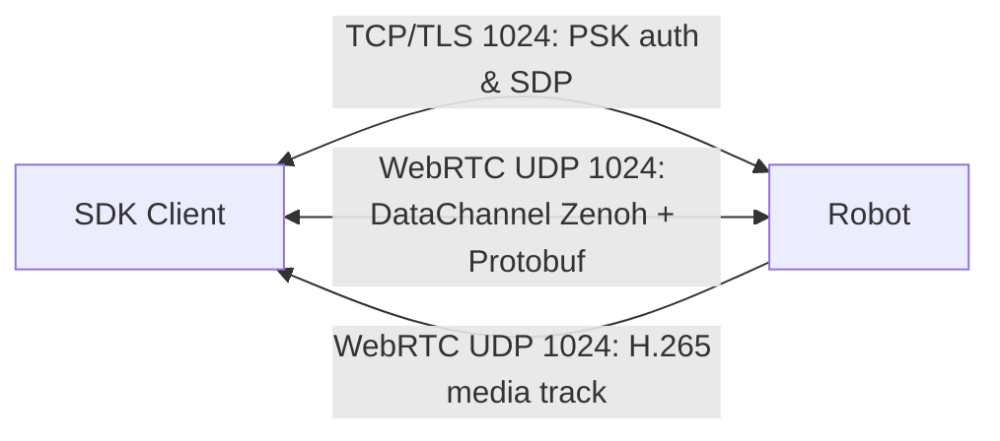
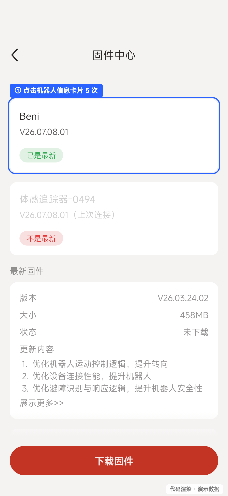
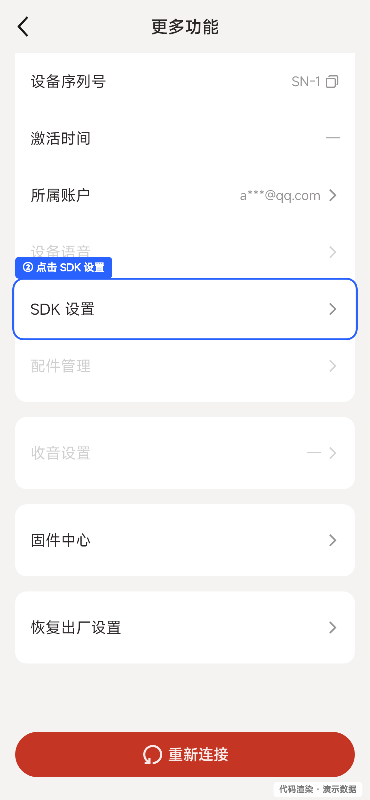
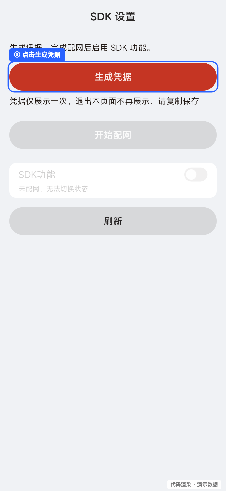
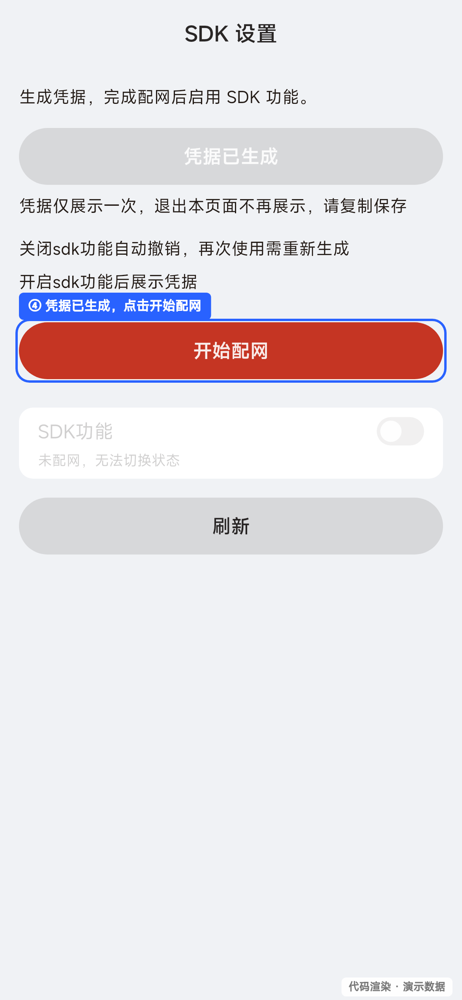
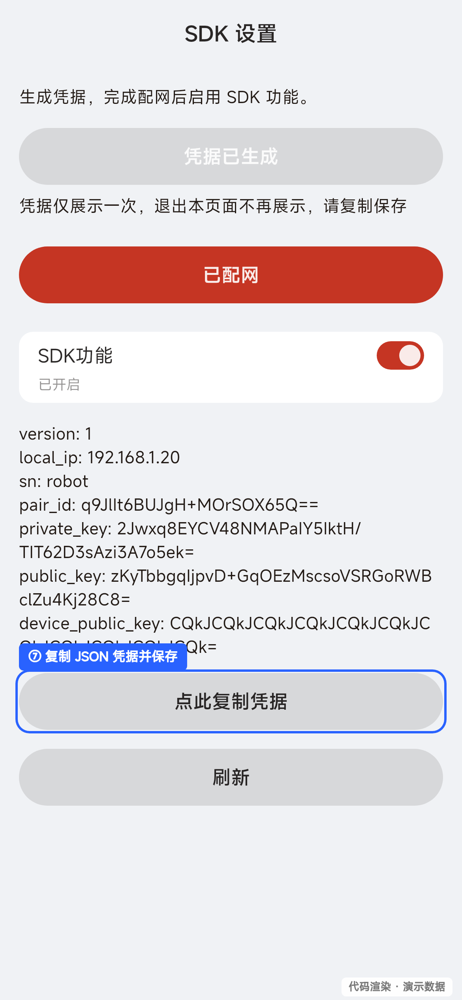
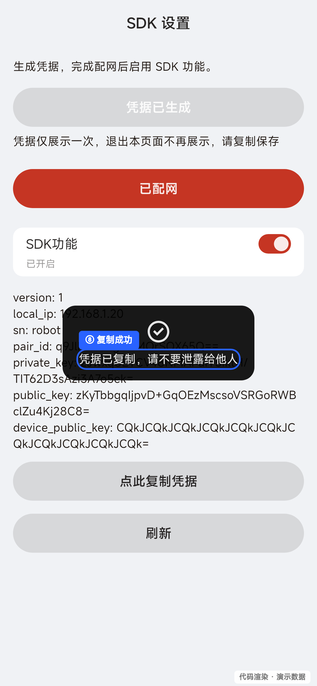
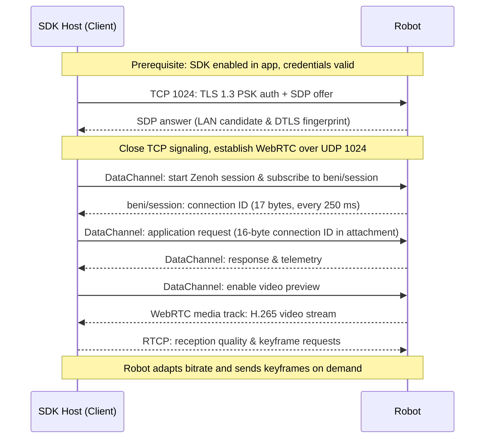

# AUTHORIZED TEST USERS ONLY — NOT AVAILABLE IN PUBLIC RELEASES

## MONDO SDK is currently in internal testing. The app entry point and related firmware capabilities described here are not available in public releases. Access is limited to users who have been granted testing permission.

## To express interest in testing, join our [Discord community](https://discord.gg/smcZyv5efa) and wait for further announcements about test access and permissions.

# MONDO SDK User Guide

[中文版本](<MONDO SDK使用简介.md>)

> Note: The app screenshots below show the Chinese UI; the steps and captions walk you through each action in English.

This guide covers how to connect a Linux or WSL client application (referred to as the **client**) to a Beni robot over your local network—from generating credentials in the Mondo app to establishing WebRTC, sending control commands, and receiving live H.265 video. For the full list of 78 topics and fields, see the [Beni SDK Open Protocol Reference](protocol-reference.en.md).

---

## 1. Overview

Connecting to Beni over LAN happens in two stages:

1. **Authentication & Signaling (`TCP 1024`)**: Your client authenticates using a TLS 1.3 external PSK derived from pairing credentials, exchanges WebRTC SDP over that connection, and then closes TCP.
2. **Application Messages & Video (`WebRTC / UDP 1024`)**: Once WebRTC is up, commands, responses, and telemetry flow over a DataChannel while H.265 live video streams over a media track—both sharing UDP port `1024`.



### 1.1 Setting Up Access in the Mondo App

First-time setup takes five steps in the Mondo app: **Open SDK Settings → Generate Credentials → Configure Wi-Fi → Enable SDK → Copy & Save Credentials**. Afterward, make sure your development machine and the robot can reach each other on the local network.

#### Step 1: Reveal SDK Settings

1. Sign in to the Mondo app with the robot owner's account, connect directly to the target robot, and verify its serial number (`SN`). Keep the local direct connection active while generating credentials.
2. Go to **Firmware Center → Device Information** and tap the robot info card **5 times** to reveal the SDK Settings menu.
3. Go back to **Device Management** and open **SDK Settings**.

> Tapping the robot info card 5 times again hides the menu entry. This only toggles UI visibility—it does not turn off SDK mode on the robot or revoke your credentials.

**Figure 1: Tap the robot information card 5 times**



**Figure 2: Open SDK Settings**



#### Step 2: Generate Credentials

Tap **Generate Credentials**. The app generates a dedicated SDK X25519 key pair and pairing ID (`pair_id`), then prompts you to configure Wi-Fi.

> [!WARNING]
> Credentials are shown **only once**. Make sure you copy and save them before leaving the SDK Settings page.

**Figure 3: Generate credentials**



**Figure 4: Credentials generated, ready for Wi-Fi setup**



#### Step 3: Connect the Robot to Wi-Fi

1. Tap **Configure Wi-Fi** to open **Wi-Fi Management**, and connect the robot to a Wi-Fi network with internet access.
2. Return to **SDK Settings**. If the robot is already online but the page hasn't updated, tap **Refresh**.

> The SDK switch stays disabled until Wi-Fi connectivity is confirmed. Both enabling and disabling SDK mode require internet access on the robot.

#### Step 4: Enable SDK and Copy the Credentials

1. After generating credentials on this page and confirming Wi-Fi connectivity, turn on **SDK** and wait for the device to confirm **Enabled**.
2. Once enabled, the page displays the generated credentials one field per line as “field name: value”.
3. Tap **Copy** to obtain the complete JSON. Credentials are shown only during setup; copy the JSON or save a screenshot before leaving SDK Settings for client access.

The exported JSON includes `sn`, `pair_id`, `private_key`, `public_key`, `device_public_key`, along with `local_ip` and credential generation metadata. If `local_ip` is empty, tap **Refresh**. If the robot's LAN IP later changes (for example, via DHCP), simply connect to its new IP—your existing credentials remain valid.

**Figure 5: Copy and save the JSON credentials**



**Figure 6: Copy confirmation**



#### Credential Lifecycle & Reconnecting

- **One-time display:** The app does not store the generated private key persistently. Once you leave SDK Settings, you cannot view or copy it again.
- **Robot holds the source of truth:** Closing the app, clearing app data, or hiding the menu entry does not revoke SDK authorization on the robot.
- **Disabling revokes everything:** Turning off the SDK switch immediately invalidates the old credentials and disconnects any active SDK session. You will need to generate new credentials before re-enabling.
- **Lost your saved JSON?** If the robot shows SDK enabled but you lost the credentials, disable SDK while the robot is online, wait for confirmation, then generate fresh credentials and enable it again.

### 1.2 Client Requirements

Your client reads the exported JSON and connects to the robot's current LAN IPv4 address. Make sure your environment supports:

- **TLS 1.3 external PSK** (`TLS_AES_128_GCM_SHA256`)
- **WebRTC** with a reliable, ordered binary DataChannel and an H.265 video receive track
- **Zenoh** and **Protobuf** (the DataChannel carries raw Zenoh byte streams)

### 1.3 Connection Sequence



---

## 2. LAN & WebRTC Connection

Connect to **port 1024** on the robot's current Wi-Fi IPv4 address. Your local network must allow both **TCP 1024** and **UDP 1024**. The robot accepts **only one** SDK client at a time.

| Purpose | Port / Protocol | Transport |
| --- | --- | --- |
| Authentication & SDP exchange | TCP/TLS 1024 | TLS 1.3 external PSK; Zenoh carries SDP |
| Commands, preview switch, responses, status | WebRTC / UDP 1024 | Zenoh + Protobuf over DataChannel |
| Live H.265 video | Same WebRTC / UDP 1024 | WebRTC media track (RTP/SRTP) |
| Bitrate & keyframe feedback | Same WebRTC / UDP 1024 | RTCP (multiplexed with RTP) |

### 2.1 Pairing Authentication & SDP Exchange

1. **Derive the external PSK:**
   - Compute a 32-byte X25519 shared secret using your SDK `private_key` and the robot's `device_public_key`.
   - Derive a 32-byte PSK with **HKDF-SHA256**:
     - `salt`: raw 16-byte `pair_id`
     - `info`: ASCII string `Beni LAN TLS 1.3 external PSK v1`
   - The robot derives the same key from its active pairing record.

2. **TLS 1.3 handshake:**
   - Connect to TCP port `1024` using **TLS 1.3 external PSK** with identity `Beni-SDK-v1`, cipher suite `TLS_AES_128_GCM_SHA256`, and ephemeral key exchange (ECDHE).
   - No CA or device certificate is needed, but your client must verify that the handshake actually negotiated external PSK mode.
   - The robot enforces a **3-second** TLS handshake timeout and a **30-second** total timeout for the entire signaling phase (Zenoh handshake + SDP exchange).

3. **Exchange WebRTC SDP:**
   - Create an H.265 receive video track and a **reliable, ordered, binary** DataChannel labeled `beni` (leave lifetime and max-retransmit limits unset).
   - Wait for ICE candidate gathering to finish. Over the authenticated TLS connection, open a Zenoh session, **subscribe to `device/sdk/webrtc/answer` first, then publish** the full UTF-8 SDP offer to `app/sdk/webrtc/offer` with encoding `application/octet-stream` (no session attachment is needed for signaling).
   - The robot replies with a complete UTF-8 SDP answer. Both sides verify DTLS certificates against the fingerprints in the authenticated SDP, and WebRTC negotiates media and DataChannel encryption keys automatically.

```text
app/sdk/webrtc/offer       // Client → Robot: complete UTF-8 SDP offer
device/sdk/webrtc/answer   // Robot → Client: complete UTF-8 SDP answer
encoding: application/octet-stream
```

> The robot only advertises LAN IPv4/UDP `1024` candidates—no public STUN/TURN or ICE TCP. Video and DataChannel require BUNDLE and RTCP-mux.

### 2.2 Application Session, Timeouts & Revocation

- **TCP closes after SDP:** Once SDP exchange finishes, the robot closes TCP `1024` and all traffic continues over WebRTC.
- **30-second DataChannel timeout:** If the DataChannel does not open within **30 seconds** after SDP exchange, the robot tears down the connection and you must reconnect from scratch.
- **Connection ID (`beni/session`):** Once the DataChannel is open, start a Zenoh session over it and subscribe to `beni/session`. Every **250 ms**, the robot publishes a 17-byte payload: **the first 16 bytes are the random connection ID for this session, and the last byte is reserved (`0`)**. Attach that 16-byte connection ID to every application message you send to the robot.
- **Continuous authorization:** The robot checks authorization continuously. Disabling SDK in the app, rotating credentials, or clearing authorization immediately terminates the WebRTC session. After any disconnect, authenticate again, exchange new SDP, and obtain a fresh connection ID—never reuse old IDs or pending request sequence numbers.

---

## 3. Application Messages & Encoding

### 3.1 Topic Routing

- **Client → Robot (Publish):** `app` + canonical topic (e.g., `app/cmd/common/get_version_req`).
- **Robot → Client (Subscribe):** `device` + canonical topic (e.g., `device/cmd/common/get_version_rsp`).

Common topics:

```text
Version query   app/cmd/common/get_version_req  →  device/cmd/common/get_version_rsp
Mode switch     app/cmd/mission/request         →  device/cmd/mission/request_ack
Joystick        app/cmd/rc/joystick
Scheduler       device/status/scheduler/status
Preview switch  app/cmd/vt/sdk_preview_req      →  device/cmd/vt/sdk_preview_rsp
Live video      WebRTC H.265 media track        (see Section 4.3)
```

### 3.2 Requests & Responses

- **Request/Response pairs:** Set a nonzero `uint32` `header.seq_num` on the request. Match the response by **current session, expected response key, and `header.seq_num`**.
- **One-way & telemetry:** Publish one-way commands (like joystick) directly, and subscribe to status topics for continuous updates.

### 3.3 Protobuf Framing & Transport

#### 3.3.1 Outer Envelope

All application payloads wrap their fields inside a standard Protobuf **Envelope**:

```text
Application message (Envelope)
├─ header (tag 1): message header (RcJoystick must omit the entire header)
│  └─ seq_num (tag 1): nonzero uint32 request ID when matching a response
└─ data (tag 2): message-specific payload
```

> **Encoding gotchas:**
> - Protobuf field tags are scoped per nesting level.
> - Even when a request takes no parameters (such as version query), `data` must still be encoded as an empty submessage (`12 00`).
> - **`RcJoystick` is an exception:** omit `header` completely. Even an empty `header` is rejected by firmware.

#### 3.3.2 Zenoh Over DataChannel

- Serialize the Protobuf payload into a Zenoh PUT sample with encoding `application/protobuf` and the 16-byte connection ID in `attachment`.
- Binary DataChannel messages carry the raw Zenoh byte stream with no extra framing header. A single DataChannel message may hold part of a Zenoh frame or multiple frames; read them sequentially as a byte stream and ignore empty binary messages.
- Decode incoming samples using the Protobuf definition corresponding to the full Zenoh key.

---

## 4. Common Message Types

This section covers three common message categories; for other protocols, see the [Beni SDK Open Protocol Reference](protocol-reference.en.md):

- **Application messages:** switching modes, reading/updating runtime parameters, and monitoring robot/power/fault status.
- **Manual control:** driving, gimbal control, jumps, and flips via 64-bit joystick packets.
- **Video preview:** toggling preview and receiving H.265 video.

### 4.1 Application Messages

The following field tables serve as an application encoding reference. The robot decodes supported requests, validates them against its current state and business rules, and executes them. Confirm outcomes using actual responses or status reports.

#### 4.1.1 Mode Switching (`app/cmd/mission/request` / `device/cmd/mission/request_ack`)

Robot modes are selected by a **main mode (`mission_id`)** and a **submode (`sub_mode`)**:

| `mission_id` | Main mode | Purpose |
| --- | --- | --- |
| `0` | Reserved | — |
| `1` | Camera | Photography and manual control |
| `2` | Game | Game modes |

Camera submodes:

| `sub_mode` | Submode | Purpose |
| --- | --- | --- |
| `0` | Manual | Receive client joystick input and drive according to its values |
| `1` | Spotlight | Gimbal tracks the target while joystick controls movement |
| `2` | Follow | Robot follows the target autonomously |

Below is the format for switching to **Camera / Manual (`mission_id=1, sub_mode=0`)**. Both messages use the standard [Envelope](#331-outer-envelope), and all `data` fields are required.

| Direction | Message key | Message |
| --- | --- | --- |
| Client → Robot | `app/cmd/mission/request` | Mode-switch request |
| Robot → Client | `device/cmd/mission/request_ack` | Mode-switch response |

**Request (`app/cmd/mission/request`)**

```text
Mode-switch request
├─ header (tag 1)
│  └─ seq_num (tag 1): nonzero uint32 request ID
└─ data (tag 2)
   ├─ version (tag 1): request format version
   ├─ mission_id (tag 2): target main mode
   ├─ sub_mode (tag 3): target submode
   └─ mode_params (tag 4): 9-byte mode settings
```

| `data` tag | Field | Type & description |
| --- | --- | --- |
| 1 | `version` | `uint32/u8`, always `1`. |
| 2 | `mission_id` | `uint32/u8`, `1` for Camera. |
| 3 | `sub_mode` | `uint32/u8`, `0` for Manual. |
| 4 | `mode_params` | `bytes`, exactly 9 bytes; see layout below. |

**`mode_params` 9-Byte Layout (Camera / Manual)**

| Byte index | Setting | Values |
| --- | --- | --- |
| `0` | `drive_mode` | `0`: Chassis turning and gimbal yaw are controlled independently; the gimbal holds its configured angle relative to the body, so the viewing direction turns with the body.<br>`1`: Movement is referenced to the camera heading; the gimbal holds its heading while the body steers automatically (and realigns with the gimbal when idle). |
| `1` | Reserved | Set to `0`. |
| `2` | `speed_radius_priority` | `0` off, `1` slow down during turns. |
| `3` | Reserved | Set to `0`. |
| `4` | `control_orientation` | `0` unspecified, `1` portrait, `2` landscape. |
| `5`–`8` | Reserved | Set all bytes to `0`. |

> [!TIP]
> **Watch out for byte 4:** Index `4` (the fifth byte) is **not** reserved. Setting `control_orientation=1` (portrait) forces `drive_mode=0` even if you requested `drive_mode=1`. To have the chassis follow the gimbal heading, explicitly set `drive_mode=1` and `control_orientation=2` (hex example: `01 00 00 00 02 00 00 00 00`). Physical remote-controller input always uses chassis-steering mode.

**Response (`device/cmd/mission/request_ack`)**

```text
Mode-switch response
├─ header (tag 1)
│  └─ seq_num (tag 1): echoed request ID
└─ data (tag 2)
   ├─ result_code (tag 1): result
   ├─ current_mission_id (tag 2): active main mode
   ├─ current_sub_mode (tag 3): active submode
   ├─ error_code_lo (tag 4): error code low byte
   └─ error_code_hi (tag 5): error code high byte
```

| `data` tag | Field | Type & description |
| --- | --- | --- |
| 1 | `result_code` | `uint32/u8`: `0` success, `1` main-mode error, `2` submode error, `3` mode-params error. |
| 2 | `current_mission_id` | `uint32/u8`, robot's current main mode. |
| 3 | `current_sub_mode` | `uint32/u8`, robot's current submode. |
| 4 | `error_code_lo` | `uint32/u8`, low 8 bits of error code. |
| 5 | `error_code_hi` | `uint32/u8`, high 8 bits of error code. |

**Handling responses:**
- Never reuse an in-flight `seq_num`. Retire each ID once answered or timed out, and drop late responses.
- Use a finite client timeout. On timeout, do not automatically resend the mode switch—check scheduler status first to see what mode the robot is actually in.

#### 4.1.2 Manual Runtime Parameters (`app/cmd/parameter/query_req` / `update_req`)

Query or adjust Manual driving settings such as top speed, turning angular velocity, and acceleration response.

**Parameter Directory**

| Parameter ID | Name | Unit | Valid range |
| --- | --- | --- | --- |
| `1` | Maximum speed | m/s | `0`–`8` |
| `2` | Maximum turning angular velocity | °/s | `30`–`250` |
| `3` | Acceleration response level | — | `1`, `2`, `3` |
| `16` | Body / chassis coordination weight | — | `0`–`1` |
| `17` | Filter parameter | — | `0.01`–`1` |
| `18` | Minimum-turn setting | — | `0`, `1` |

**Acceleration response (ID `3`) mapping:**

| Level | Filter `alpha` | Forward acceleration limit |
| --- | --- | --- |
| `1` | `0.01` | `2 m/s²` |
| `2` | `0.025` | `3.5 m/s²` |
| `3` | `0.05` | `5 m/s²` |

All four messages below use the standard [Envelope](#331-outer-envelope) (with `header.seq_num`), and all `data` fields are required.

**1) Query Parameter**

| Direction | Message key | Message |
| --- | --- | --- |
| Client → Robot | `app/cmd/parameter/query_req` | Parameter query request |
| Robot → Client | `device/cmd/parameter/query_rsp` | Parameter query response |

Request `data` fields:

| `data` tag | Field | Type & description |
| --- | --- | --- |
| 1 | `mode_type` | `uint32/u8`, always `1` (Manual parameter group). This only selects the parameter group and **does not switch robot mode**. |
| 2 | `param_id` | `uint32/u8`, parameter ID from the directory above. |
| 3 | `reserved` | `bytes[2]`, all zeros. |

Response `data` fields:

| `data` tag | Field | Type & description |
| --- | --- | --- |
| 1 | `mode_type` | `uint32/u8`, echoed group ID (`1`). |
| 2 | `param_id` | `uint32/u8`, echoed parameter ID. |
| 3 | `ret_code` | `uint32/u8`: `0` success, `1` unsupported parameter, `2` unsupported mode. |
| 4 | `reserved` | `uint32/u8`, `0`. |
| 5 | `param_value` | `float/f32`, current value. |

**2) Update Parameter**

| Direction | Message key | Message |
| --- | --- | --- |
| Client → Robot | `app/cmd/parameter/update_req` | Parameter update request |
| Robot → Client | `device/cmd/parameter/update_rsp` | Parameter update response |

Request `data` fields:

| `data` tag | Field | Type & description |
| --- | --- | --- |
| 1 | `mode_type` | `uint32/u8`, always `1`. |
| 2 | `param_id` | `uint32/u8`, parameter ID to update. |
| 3 | `param_value` | `float/f32`, target value (must be finite; `NaN` and `Inf` are rejected). |
| 4 | `reserved` | `bytes[2]`, all zeros. |

Response `data` fields:

| `data` tag | Field | Type & description |
| --- | --- | --- |
| 1 | `ret_code` | `uint32/u8`: `0` applied, `1` invalid, `2` unsupported, `3` storage error. |
| 2 | `reserved` | `bytes[3]`, all zeros. |

**Required handling rules**

| Rule | Handling |
| --- | --- |
| Response matching | Match by current session, expected response key, and `header.seq_num`. Query responses also echo `mode_type`/`param_id`. Update responses contain neither parameter ID nor effective value, so maintain a `seq_num → (mode_type, param_id)` map. Do not reuse outstanding sequence numbers; retire them after waiting ends, and do not let late or unmatched responses complete other requests. |
| Waiting and timeouts | Use a finite wait; the protocol specifies no universal timeout. Treat a timeout as an unknown result: retry queries with a new sequence number, and query the current value after an update timeout without automatically replaying the update. |
| Parameter confirmation | Before control, query parameters `1/2/3/16/17/18` and establish the target configuration. Perform updates as: query & save original → explicitly update → match response → query again, checking the update response and effective value separately. |
| Persistence and writes | Parameters persist across disconnects and do not revert automatically. Writes can affect current driving and later input; handle persistence failures by return code. Do not rely on out-of-range clamping to express intent, and do not write `0` to a parameter as a stop command. |

#### 4.1.3 Status Queries & Telemetry

**Status message directory**

| Status | Message key | How to receive |
| --- | --- | --- |
| [Scheduler status](#scheduler-status-devicestatusschedulerstatus) | `device/status/scheduler/status` | Subscribe to push updates |
| [Robot status](#robot-status-devicestatusrobotstatus) | `device/status/robot/status` | Subscribe to push updates |
| [Power status](#power-status-devicestatuspmuosd_status) | `device/status/pmu/osd_status` | Subscribe to push updates |
| [HMS faults](#hms-faults) | `app/status/hms/query_active`, etc. | Query snapshot + subscribe to events |

##### Scheduler Status (`device/status/scheduler/status`)

Pushed by the robot with current mode and safety flags (`header` omitted, `data` only).

```text
Scheduler status (omit header)
└─ data (tag 2)
   ├─ current_mode (tag 1): current main mode
   ├─ sub_mode (tag 2): current submode
   ├─ request_source (tag 3): raw request-source value
   ├─ is_locked (tag 4): folded/standing state
   ├─ is_paused (tag 5): emergency-stop state
   ├─ timestamp_ns (tag 6): raw device time counter
   ├─ sub_mode_state (tag 7): 14-byte submode state
   ├─ ego_active (tag 8): raw value
   └─ obstacle_avoidance_flags (tag 9): obstacle-avoidance flags
```

| `data` tag | Field | Type & description |
| --- | --- | --- |
| 1 | `current_mode` | `uint32/u8`, active main mode (`1` = Camera). |
| 2 | `sub_mode` | `uint32/u8`, active submode (`0` = Manual). |
| 3 | `request_source` | `uint32/u8`, internal source code; do not use to infer exclusive control. |
| 4 | `is_locked` | `uint32/u8`, posture: `0` standing, `1` folded. |
| 5 | `is_paused` | `uint32/u8`, emergency stop: `0` normal, `1` e-stop (halts all motion input and holds stationary). |
| 6 | `timestamp_ns` | `uint64/u64`, device-internal monotonic counter (not Unix time; do not subtract from client wall clock). |
| 7 | `sub_mode_state` | `bytes[14]`, submode details; see Manual layout below. |
| 8 | `ego_active` | `uint32/u8`, internal field; do not use to infer exclusive control. |
| 9 | `obstacle_avoidance_flags` | `uint32/u8`: `bit0` requested, `bit1` active, `bit2` intervening, `bit3` four-state layout supported; other bits reserved. |

**Manual `sub_mode_state` Byte Layout**

| Byte index | Meaning |
| --- | --- |
| `0` | Gimbal/body coordination: `0` separate control, `1` movement referenced to camera heading with automatic body steering. |
| `1` | Auto forward/reverse: `0` turn toward target then drive forward, `1` allow reverse travel to reduce body turning (only active when byte `0` is `1`). |
| `2` | Speed / turn-radius priority: `0` off, `1` on. |
| `3` | Current speed gear: `0` slow, `1` normal, `2` sport. |
| `4` | Control feature flags: when `bit7=1`, read `bit0`=heading closed-loop, `bit1`=braking, `bit2`=turn assist (`0` off / `1` on); `bit3`–`bit6` are `0`. |
| `5`–`13` | Reserved (`0`). |

##### Robot Status (`device/status/robot/status`)

Pushed by the robot with body state, speed, attitude, and odometry (`header` omitted, `data` only).

| `data` tag | Field | Type & description |
| --- | --- | --- |
| 1 | `robot_state` | `uint32/u8`: `0` Released, `1` StandingUp, `2` SittingDown, `3` Active. Note: `Active` can also appear during recovery, and `Released` can follow a critical fault. |
| 2 | `velocity` | `sint32/i16`, speed in `cm/s` (divide by 100 for `m/s`). |
| 3 | `trip_odom_dis` | `float/f32`, trip distance in `m`. |
| 4 | `obstacle_dis` | `uint32/u16`, obstacle distance in `cm`; `0xFFFF` = invalid. |
| 5 | `pitch_angle` | `sint32/i16`, pitch angle in `0.1°`. |
| 6 | `gimbal_angle` | `sint32/i16`, gimbal yaw angle in `0.1°`. |
| 7 | `roll_angle` | `sint32/i16`, roll angle in `0.1°`. |
| 8 | `height` | `uint32/u8`, measured body height in `0.1 cm`. |
| 9 | `sport_mode` | `uint32/u8`, internal motion-mode code; not an action-success or control-admission response. |
| 10 | `abnormal_flags` | `uint32/u32`, nonzero indicates an abnormality. |
| 11 | `session_odom_dis` | `float/f32`, session distance in `m`. |

##### Power Status (`device/status/pmu/osd_status`)

Pushed by the robot with battery and charging state (`header` omitted, `data` only).

```text
Power status (omit header)
└─ data (tag 2)
   ├─ soc (tag 1): battery percentage
   ├─ power_bits (tag 2): power and charging flags
   └─ abnormal_flags (tag 3): abnormality flags
```

| `data` tag | Field | Type & description |
| --- | --- | --- |
| 1 | `soc` | `uint32/u8`, battery percentage (`0`–`100`). |
| 2 | `power_bits` | `uint32/u8`: `bit0` external power connected, `bit1` charging; other bits reserved. |
| 3 | `abnormal_flags` | `uint32/u16`, nonzero means a power abnormality is present. |

##### HMS Faults

HMS (Health Management System) syncs active robot faults using a **full snapshot + incremental event** model. See the [HMS Fault Code Reference](hms-fault-codes.en.md) for code definitions.

| Direction | Message key | Message |
| --- | --- | --- |
| Client → Robot | `app/status/hms/query_active` | Query active-fault snapshot |
| Robot → Client | `device/status/hms/active_snapshot` | Full active-fault snapshot |
| Robot → Client | `device/status/hms/event_broadcast` | Fault asserted / cleared / updated event |

**1) Active-Fault Query (`app/status/hms/query_active`, omit `header`)**

| `data` tag | Field | Type & description |
| --- | --- | --- |
| 1 | `filter_kind` | `uint32/u8`: `0` all modules, `1` specific module. |
| 2 | `_pad0` | `uint32/u8`, reserved, set to `0`. |
| 3 | `module_id` | `uint32/u16`, `0` for all modules, or the target module ID. |
| 4 | `request_id` | `uint64/u64`, nonzero query ID echoed in the snapshot response. |

**2) Active-Fault Snapshot (`device/status/hms/active_snapshot`, omit `header`)**

| `data` tag | Field | Type & description |
| --- | --- | --- |
| 1 | `at_offset` | `uint64/u64`, latest fault-event sequence covered by this snapshot. |
| 2 | `count` | `uint32/u32`, number of active faults (`0`–`256`). |
| 3 | `module_ids` | `repeated uint32`, module IDs (> 0). |
| 4 | `fault_codes` | `repeated uint32`, full 32-bit fault codes (high 16 bits = module ID). |
| 5 | `instance_ids` | `repeated uint32`, instance IDs (`0`–`65535`) distinguishing instances of the same code. |
| 6 | `severities` | `repeated uint32`: `0` info, `1` warning, `2` error, `3` fatal. |
| 7 | `first_assert_ts` | `repeated uint64`, first-seen time counters in `ms` (device-internal clock). |
| 8 | `last_update_ts` | `repeated uint64`, last-updated time counters in `ms` (same clock). |
| 9 | `daemon_instance_id` | `uint64/u64`, nonzero HMS daemon instance ID; re-query if it changes. |
| 10 | `state_revision` | `uint64/u64`, fault-state revision number. |
| 11 | `recovery_state` | `uint32`: `0` invalid, `1` recovering, `2` ready. |
| 12 | `ret_code` | `uint32/u32`: `0` success, `1` invalid filter, `2` capacity exceeded. |
| 13 | `request_id` | `uint64/u64`, echoed query ID. |

> Fields 3–8 are parallel arrays of length `count`—entries at index `i` describe the same fault. Validate that `count` is in `0`–`256`, all six arrays have length `count`, `severities[i]` is in `0`–`3`, `first_assert_ts[i] ≤ last_update_ts[i]`, and each `(fault_code, instance_id)` pair is unique.

**3) Fault Event (`device/status/hms/event_broadcast`, omit `header`)**

| `data` tag | Field | Type & description |
| --- | --- | --- |
| 1 | `offset` | `uint64/u64`, monotonic event sequence number for gap detection. |
| 2 | `module_id` | `uint32/u16`, module ID. |
| 3 | `fault_code` | `uint32/u16`, low 16 bits of the fault code. |
| 4 | `instance_id` | `uint32/u16`, fault instance ID. |
| 5 | `kind` | `uint32/u8`: `1` asserted, `2` cleared, `3` updated. |
| 6 | `severity` | `uint32/u8`: `0` info, `1` warning, `2` error, `3` fatal. |
| 7 | `timestamp_ms` | `uint64/u64`, event time counter in `ms` (device-internal clock). |
| 8 | `daemon_instance_id` | `uint64/u64`, HMS daemon instance ID. |
| 9 | `state_revision` | `uint64/u64`, fault-state revision. |
| 10 | `origin` | `uint32/u8`: `0` invalid, `1` live change, `2` resync, `3` source disconnected. |
| 11 | `recovery_state` | `uint32/u8`: `0` invalid, `1` recovering, `2` ready. |

Reconstruct the full 32-bit fault code from an event as:

```text
full_fault_code = (module_id << 16) | fault_code
```

**Recommended sync flow:**
1. **Subscribe before querying:** Subscribe to `active_snapshot` and `event_broadcast` before sending `query_active`.
2. **Trust only valid, ready snapshots:** Accept a snapshot only when it matches your connection and `request_id`, has `ret_code=0`, `recovery_state=2` (ready), and passes array validation. If a query fails or is not ready, keep any existing safety restrictions active and query again.
3. **Handle events safely:**
   - The simplest approach is to mark your local fault list stale when events arrive and coalesce bursts into a single snapshot query.
   - If you apply events incrementally, verify that `daemon_instance_id` matches and that `state_revision` and `offset` are consecutive; if you see a gap, rollback, or new daemon instance, re-query a full snapshot immediately.

---

### 4.2 Manual Control (`app/cmd/rc/joystick`)

Before sending motion commands, switch to **Camera / Manual** via `app/cmd/mission/request`, and check scheduler + robot status to confirm the robot is standing (`is_locked=0`), not in emergency stop (`is_paused=0`), in `Active` state, and free of abnormalities.

**Message format:**
- **Message key:** `app/cmd/rc/joystick` (one-way publish, no response)
- **Zenoh:** encoding `application/protobuf`, with the 16-byte connection ID in `attachment`.
- **Protobuf:** encode only `data.joystick` (64-bit unsigned integer) and **omit `header` completely** (even an empty `header` is rejected by firmware).
  - Serialization check: `data.joystick = 1000` encodes to `12 03 08 E8 07`.

**Control tips:**
- The 64-bit bitfield packs forward/reverse, steering, gimbal yaw, pitch, body roll, height, jump, flip, speed gear, navigation level, emergency stop, fold/stand, plus `bit60` (pitch input mode), `bit61` (third-person mode), `bit62` (jump mode), and `bit63` (inverted preview switch). See [Protocol Reference — `/cmd/rc/joystick`](protocol-reference.en.md#t/cmd/rc/joystick) for exact bit positions and jump/flip frame timing.
- Forward and turn axes typically range from `0` to `2000`, with `1000` as neutral.
- Values are forwarded as-is to the robot, which arbitrates priority with any connected physical remote controller.
- **Watchdog timeout:** If no new joystick frame arrives for **500 ms**, the robot treats control input as lost. Send frames continuously at **50 Hz** (every 20 ms) while driving.

---

### 4.3 Video Preview (`app/cmd/vt/sdk_preview_req` / `device/cmd/vt/sdk_preview_rsp`)

Video preview starts **off** on every new SDK session and must be turned on explicitly. Preview is independent of manual driving—you can stream video without enabling manual control.

**Enabling, disabling, or querying preview:**
- Subscribe to `device/cmd/vt/sdk_preview_rsp`, then publish a request to `app/cmd/vt/sdk_preview_req`:

```text
{
    header: { seq_num },  // Nonzero request ID matched by the response
    data: {
        version: 1,       // Always 1
        operation,        // 0 = query, 1 = set
        enabled,          // 0 = off, 1 = on
        session_id        // 16-byte connection ID from beni/session
    }
}
```

- **Response fields:**
  - `ret_code`: `0` success; `1` invalid session ID or WebRTC media not ready; `2` invalid parameter.
  - `enabled`: confirmed preview state (`0` off, `1` on).

#### 4.3.1 Receiving H.265 Video

Once enabled, the robot streams H.265 video over the WebRTC media track (RTP/SRTP). Reassemble incoming RTP packets into complete access units and pass them to your H.265 decoder.

#### 4.3.2 Adaptive Bitrate, Keyframes & Stopping

- **RTCP** carries reception quality and keyframe requests (PLI/FIR). The robot adjusts encoder bitrate based on network feedback, retransmits lost packets, and requests a fresh keyframe whenever preview starts, resumes, or a keyframe request arrives.
- Send `operation=1, enabled=0` to stop preview and confirm via the response. The robot stops queuing new frames (a few in-flight frames may still arrive), while the DataChannel remains open.
- If the WebRTC session disconnects, reconnect and enable preview again.

---

For all 78 topics and detailed fault codes, see:
- [Beni SDK Open Protocol Reference](protocol-reference.en.md)
- [HMS Fault Code Reference](hms-fault-codes.en.md)
