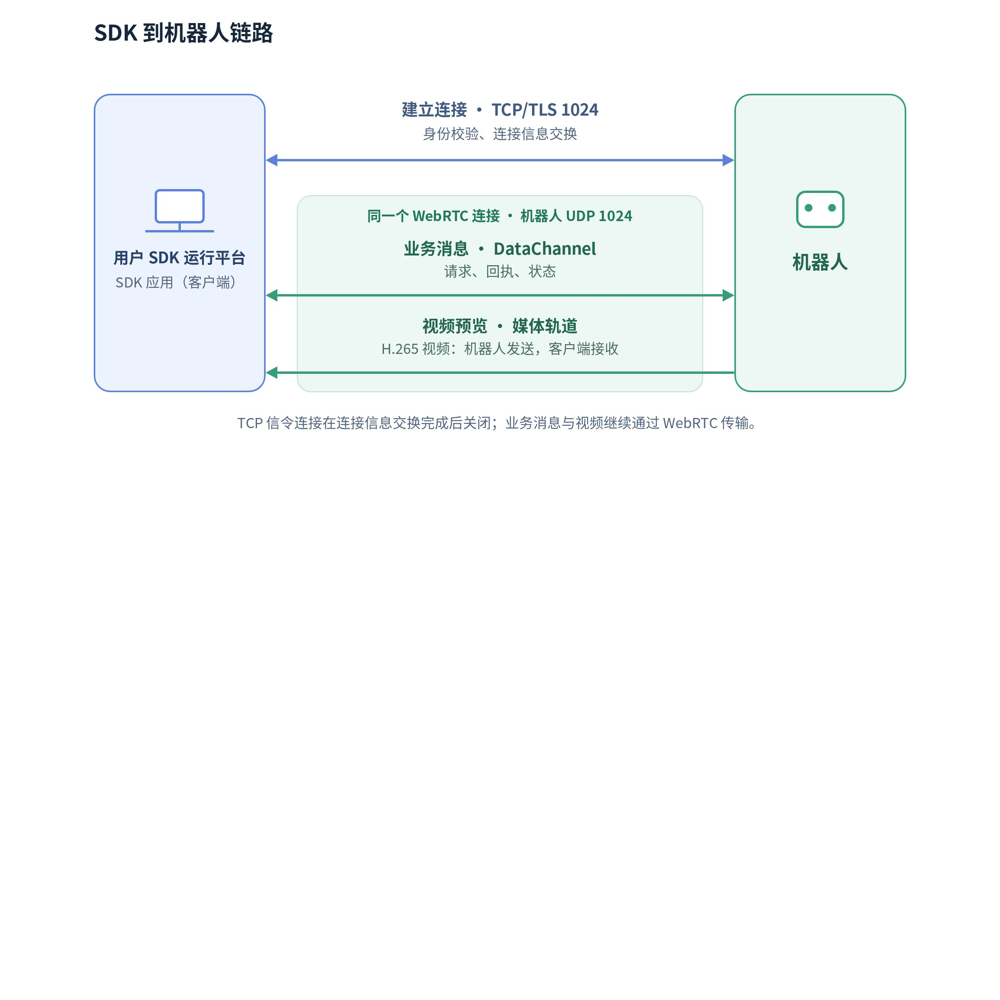
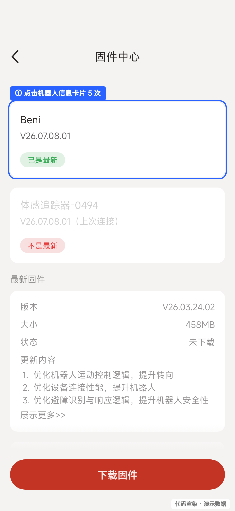
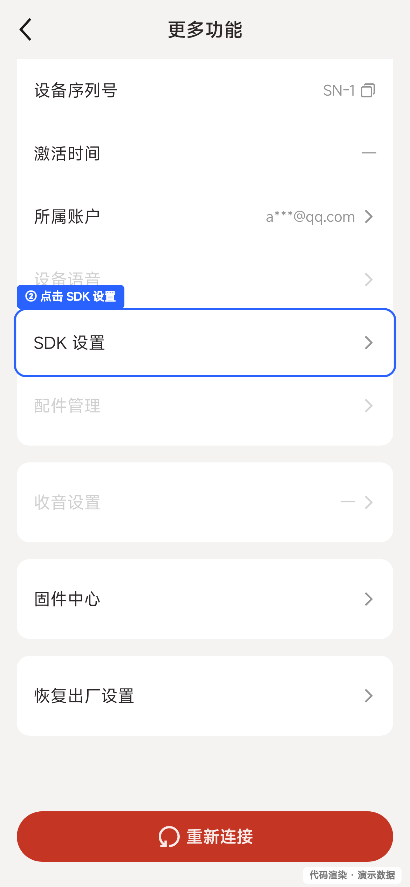
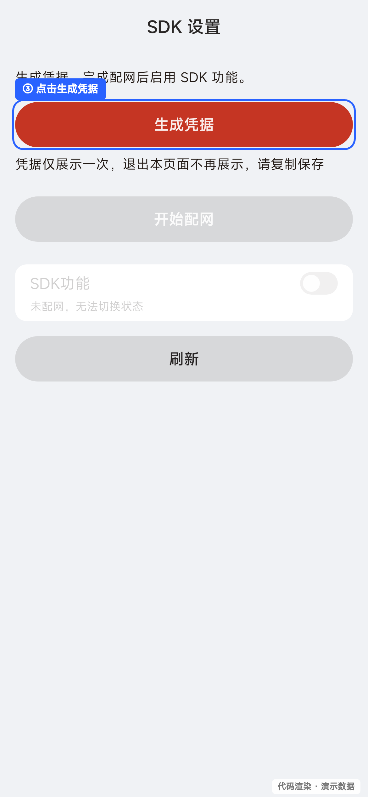
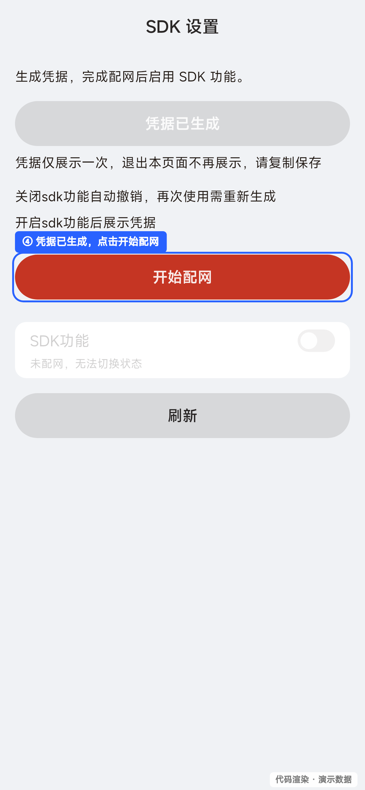
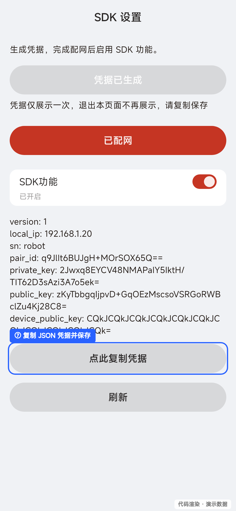
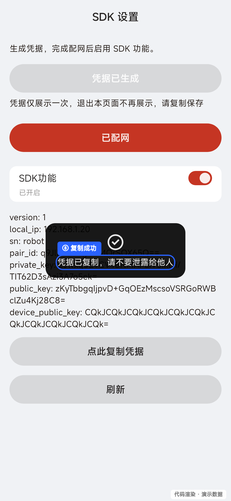
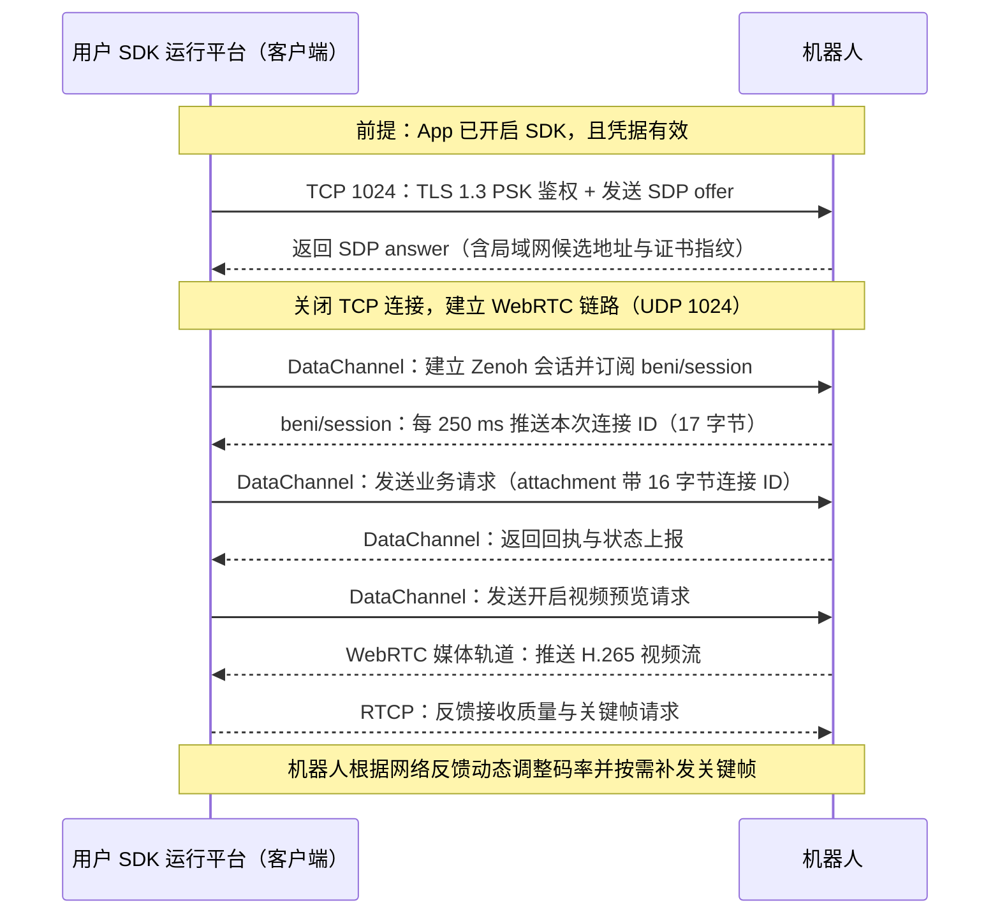

# 仅限授权内测用户｜公开版本暂不可用

## MONDO SDK 当前处于内部测试阶段。本文介绍的 App 入口和相关固件能力尚未在公开发布版本中开放，仅获得测试权限的用户可使用。

## 若希望参与测试，请加入我们的 [Discord 社群](https://discord.gg/smcZyv5efa)，等待后续测试开放通知及权限安排。

# MONDO SDK 使用简介

[English version](<MONDO SDK User Guide.en.md>)

本文介绍如何在 Linux / WSL 环境下开发 Beni 局域网客户端程序（下文简称“客户端”），涵盖 App 配对准备、网络建连、消息收发、手动控制和视频预览。完整协议字段请参考 [Beni SDK 开放协议手册](protocol-reference.md)。

---

## 1. 整体流程

客户端和机器人通过局域网通信，整个过程分为两步：

1. **鉴权与协商（TCP 1024）**：客户端先通过 TLS 1.3 外部 PSK（预共享密钥）完成配对鉴权，再通过这条连接交换 WebRTC SDP，完成后关闭 TCP 连接。
2. **业务与视频（WebRTC / UDP 1024）**：建立 WebRTC 连接后，控制命令、状态上报走 DataChannel，H.265 实时画面走视频媒体轨道，两者共用机器人的 UDP 1024 端口。



### 1.1 在 App 中准备接入

首次接入需要先在 Mondo App 中完成五个步骤：**打开 SDK 设置 → 生成凭据 → 配网 → 开启 SDK → 复制并保存凭据**。之后确保开发机和机器人处于可互通的局域网即可。

#### 第 1 步：打开 SDK 设置入口

1. 用机器人所有者账号登录 Mondo App，近场直连目标机器人并核对设备 SN（生成凭据时需保持与机器人的本地直连）。
2. 进入 **「固件中心」→「设备信息」**，连续点击机器人信息卡片 **5 次**，即可显示 SDK 设置入口。
3. 返回 **「设备管理」**，点击进入 **「SDK 设置」**。

> 再次连点机器人信息卡片 5 次可隐藏入口。隐藏入口只影响 App 菜单显示，不会关闭机器人上的 SDK 功能，也不会让已有凭据失效。

**图 1：连点机器人信息卡片 5 次**



**图 2：进入 SDK 设置**



#### 第 2 步：生成凭据

点击 **「生成凭据」**，App 会为当前客户端生成一套独立的 SDK 密钥对和配对标识（`pair_id`），然后引导你进入下一步配网。

> [!WARNING]
> 凭据只会在本次设置页面展示一次，退出页面后无法再次查看或找回，请务必及时复制保存。

**图 3：生成凭据**



**图 4：凭据已生成，准备配网**



#### 第 3 步：给机器人配网

1. 点击 **「开始配网」** 进入 **「Wi-Fi 管理」**，把机器人连上可访问互联网的 Wi-Fi。
2. 配网完成后返回 **「SDK 设置」**。如果机器人已经连上网但页面状态没更新，点一下 **「刷新」**。

> 在确认机器人 Wi-Fi 在线之前，SDK 功能开关处于不可点击状态。开启和关闭 SDK 功能都需要机器人联网。

#### 第 4 步：开启 SDK 并复制凭据

1. 本页已生成凭据且机器人 Wi-Fi 在线后，打开**「SDK功能」**开关，等待设备状态确认**「已开启」**。
2. 启用后，页面以“字段名:字段值”的形式逐行展示本次生成的凭据
3. 点击复制，取得完整 JSON。凭据仅设置时展示一次，请在退出 SDK 设置前复制或截图保存好 JSON，供客户端接入使用。

导出的 JSON 包含 `sn`、`pair_id`、`private_key`、`public_key`、`device_public_key`，以及 `local_ip` 和凭据代次信息。如果 `local_ip` 为空可以先刷新；后续如果路由器给机器人分配了新 IP，直接改连机器人当前的局域网 IP 即可，不需要重新配对。

**图 5：复制并保存 JSON 凭据**



**图 6：复制成功提示**



#### 凭据有效期与重新接入

- **私钥只展示一次**：App 不会持久保存生成的私钥，退出 SDK 设置页后无法找回。
- **授权状态以机器人为准**：退出 App、清理 App 数据或隐藏菜单入口，都不会撤销机器人上的 SDK 授权。
- **关闭开关即撤销**：在 App 中关闭 SDK 功能后，旧凭据会立即作废，正在运行的 SDK 会话也会断开；下次使用需要重新生成凭据并开启。
- **凭据弄丢了怎么办**：如果页面显示 SDK 已开启但你丢了 JSON，请先在机器人联网状态下关闭 SDK，确认关闭后再重新生成并开启。

### 1.2 客户端环境要求

客户端读取 App 导出的 JSON 凭据后，直接连接机器人当前的局域网 IPv4 地址。你的客户端运行环境需要支持：

- **TLS 1.3 外部 PSK**（`TLS_AES_128_GCM_SHA256`）
- **WebRTC**：支持可靠、有序的二进制 DataChannel，以及 H.265 视频接收轨道
- **Zenoh** 与 **Protobuf**（DataChannel 内部直接承载标准 Zenoh 字节流）

### 1.3 通信时序



---

## 2. 局域网建连与 WebRTC 

机器人监听在当前 Wi-Fi 局域网 IPv4 地址的 **1024 端口**，局域网防火墙需同时放行 **TCP 1024** 和 **UDP 1024**。机器人同一时间**只允许一个 SDK 客户端连接**。

| 用途 | 端口与协议 | 承载方式 |
| --- | --- | --- |
| 身份鉴权与 SDP 交换 | TCP/TLS 1024 | TLS 1.3 外部 PSK；连接内用 Zenoh 交换 SDP |
| 控制指令、预览开关、回执与状态 | WebRTC / UDP 1024 | DataChannel 内传输 Zenoh 字节流与 Protobuf |
| H.265 实时视频 | 同一 WebRTC / UDP 1024 | WebRTC 视频媒体轨道（RTP/SRTP） |
| 码率与关键帧反馈 | 同一 WebRTC / UDP 1024 | RTCP（与 RTP 复用端口） |

### 2.1 配对鉴权与 SDP 交换

1. **派生外部 PSK**：
   - 客户端用自己的 SDK X25519 私钥和机器人的 X25519 公钥（`device_public_key`）做 ECDH，算出 32 字节共享秘密。
   - 使用 **HKDF-SHA256** 派生 32 字节外部 PSK：
     - `salt`：原始 16 字节 `pair_id`
     - `info`：ASCII 字符串 `Beni LAN TLS 1.3 external PSK v1`
   - 机器人会用当前生效的配对记录算出同样的 PSK。

2. **TLS 1.3 握手**：
   - 连接机器人 TCP 1024，使用 **TLS 1.3 外部 PSK** 认证，PSK 身份标识为 `Beni-SDK-v1`，加密套件固定为 `TLS_AES_128_GCM_SHA256`，且必须启用临时密钥交换（ECDHE）。
   - 无需额外配置 CA 或设备证书，但客户端须确认握手确实走了外部 PSK 模式。
   - 机器人侧 TLS 握手超时为 **3 秒**，握手之后的整个信令阶段（Zenoh 握手 + SDP 交换）总超时为 **30 秒**。

3. **交换 WebRTC SDP**：
   - 客户端创建一个 H.265 视频接收轨道，以及一个名为 `beni` 的**可靠、有序、二进制** DataChannel（不要设置消息寿命或最大重传次数限制）。
   - 等本地 ICE 候选收集完毕后，在已鉴权的 TLS 连接上建立 Zenoh 会话，**先订阅 `device/sdk/webrtc/answer`，再往 `app/sdk/webrtc/offer` 发布**完整的 UTF-8 SDP offer（`encoding` 设为 `application/octet-stream`，这两条信令消息不需要带业务会话 attachment）。
   - 机器人收到 offer 后返回完整的 UTF-8 SDP answer。双方依据已认证 SDP 中的证书指纹校验 DTLS 证书，后续媒体与 DataChannel 加密由 WebRTC 自动协商。

```text
app/sdk/webrtc/offer       // 客户端 → 机器人：完整 UTF-8 SDP offer
device/sdk/webrtc/answer   // 机器人 → 客户端：完整 UTF-8 SDP answer
encoding: application/octet-stream
```

> 机器人只在 Wi-Fi 局域网 IPv4 / UDP 1024 上生成候选地址，不使用公网 STUN/TURN 或 ICE TCP。视频轨道与 DataChannel 强制使用 BUNDLE 和 RTP/RTCP 端口复用（RTCP-mux）。

### 2.2 业务会话、超时与授权撤销

- **关闭 TCP 信令**：SDP 交换完成后，机器人会主动关闭 TCP 1024 信令连接，后续通信全部走 WebRTC。
- **30 秒建连限时**：SDP 交换结束后 **30 秒内**如果 DataChannel 还没打开，机器人会回收本次连接；客户端需要重新鉴权、交换 SDP。
- **获取连接 ID**：DataChannel 打开后，在其中建立业务 Zenoh 会话并订阅 `beni/session`。机器人每 **250 ms** 会推送一次 17 字节消息：**前 16 字节是本次会话的随机连接 ID，最后 1 字节为保留位（当前固定为 0）**。后续客户端发往机器人的每一条业务消息，都必须在 Zenoh `attachment` 中带上这 16 字节连接 ID。
- **持续鉴权**：会话期间机器人会持续检查授权状态。一旦在 App 中关闭 SDK、更换凭据或清空授权，机器人会立刻断开当前 WebRTC 会话。断线后不能复用旧的连接 ID 或未完成的请求序号，必须完整重新建连。

---

## 3. 业务消息与编码规则

### 3.1 路由命名规则

- **发给机器人（Publish）**：Key 格式为 `app` + 规范 topic，例如 `app/cmd/common/get_version_req`。
- **接收机器人消息（Subscribe）**：Key 格式为 `device` + 规范 topic，例如 `device/cmd/common/get_version_rsp`。

常用消息一览：

```text
版本查询   app/cmd/common/get_version_req  →  device/cmd/common/get_version_rsp
模式切换   app/cmd/mission/request         →  device/cmd/mission/request_ack
摇杆控制   app/cmd/rc/joystick             
调度状态   device/status/scheduler/status  
预览开关   app/cmd/vt/sdk_preview_req      →  device/cmd/vt/sdk_preview_rsp
实时视频   WebRTC H.265 媒体轨道            （见第 4.3 节）
```

### 3.2 请求与回执匹配

- **请求 / 回执类消息**：发送时在 `header.seq_num` 填入一个非零的 `uint32` 编号，机器人回执时会原样带回。匹配回执时，须同时校验**当前会话、对应的响应 Key 以及 `header.seq_num`**。
- **单向控制与状态上报**：摇杆等单向指令直接发布；机身、电源、调度等状态直接订阅对应 topic 即可。

### 3.3 Protobuf 封装与传输

#### 3.3.1 外层 Envelope 结构

所有业务消息的 Protobuf 外层都是统一的 **Envelope** 结构：

```text
业务消息（Envelope）
├─ header（tag 1）：消息头（RcJoystick 必须完全省略整个 header）
│  └─ seq_num（tag 1）：需要匹配回执时填非零 uint32 编号
└─ data（tag 2）：具体业务字段
```

> **编码注意点**：
> - Protobuf 的 tag 编号在每一层独立计数。
> - 即使某个请求没有任何业务参数（如版本查询），`data` 也必须编码为空子消息（`12 00`），不能省略。
> - **`RcJoystick` 是特例**：必须彻底省略整个 `header` 字段，哪怕填一个空的 `header` 也会被固件拒收。

#### 3.3.2 在 DataChannel 上收发 Zenoh 字节流

- 发布业务消息时，将 Protobuf 序列化后的字节作为 Zenoh PUT 的 `payload`，`encoding` 设为 `application/protobuf`，`attachment` 填当前 16 字节连接 ID。
- DataChannel 二进制消息直接承载原始 Zenoh 字节流，不额外加自定义包头。一次 DataChannel 消息可能包含半个 Zenoh 帧，也可能包含多个 Zenoh 帧，按字节流顺序连续读取即可；空的二进制消息直接忽略。
- 收到机器人推送的样本后，根据完整的 Zenoh Key 查找对应的 Protobuf 结构进行解码。

---

## 4. 常用协议详解

本章介绍三类常用的数据包，其余协议请查阅 [Beni SDK 开放协议手册](protocol-reference.md)：

- **业务消息**：切换模式、查询/修改手动控制参数、订阅机器人状态与故障。
- **手动控制**：通过 64 位摇杆指令控制移动、云台、跳跃和空翻。
- **视频预览**：开关预览与接收 H.265 媒体流。

### 4.1 业务消息

下列字段表用作业务编码参考。机器人对支持的请求按协议解码，根据当前状态和相应业务规则校验、执行。客户端应以实际回执或状态上报确认结果。

#### 4.1.1 模式切换（`app/cmd/mission/request` / `device/cmd/mission/request_ack`）

机器人的工作模式分为**主模式（`mission_id`）**和**子模式（`sub_mode`）**：

| `mission_id` | 主模式 | 说明 |
| --- | --- | --- |
| `0` | 保留 | — |
| `1` | Camera | 拍摄与手动控制 |
| `2` | Game | 游戏模式 |

Camera 主模式下的子模式：

| `sub_mode` | 子模式 | 说明 |
| --- | --- | --- |
| `0` | Manual（手动） | 接收客户端摇杆指令输入，按照输入摇杆量执行运动 |
| `1` | Spotlight（聚焦） | 云台自动锁定目标，摇杆控制机器人移动 |
| `2` | Follow（跟随） | 机器人自主跟随目标 |

下面以最常用的 **Camera / Manual（`mission_id=1, sub_mode=0`）** 为例说明请求和回复格式。两者均使用标准 [Envelope 结构](#331-外层-envelope-结构)，表中所有 `data` 字段均为必填。

| 方向 | 完整消息键 | 说明 |
| --- | --- | --- |
| 客户端 → 机器人 | `app/cmd/mission/request` | 模式切换请求 |
| 机器人 → 客户端 | `device/cmd/mission/request_ack` | 模式切换回复 |

**请求包（`app/cmd/mission/request`）**

```text
模式切换请求
├─ header（tag 1）
│  └─ seq_num（tag 1）：非零 uint32 请求编号
└─ data（tag 2）
   ├─ version（tag 1）：请求格式版本
   ├─ mission_id（tag 2）：目标主模式
   ├─ sub_mode（tag 3）：目标子模式
   └─ mode_params（tag 4）：9 字节模式设置
```

| `data` tag | 字段 | 类型与说明 |
| --- | --- | --- |
| 1 | `version` | `uint32/u8`，固定填 `1`。 |
| 2 | `mission_id` | `uint32/u8`，`1` 表示 Camera 主模式。 |
| 3 | `sub_mode` | `uint32/u8`，`0` 表示 Manual 子模式。 |
| 4 | `mode_params` | `bytes`，固定 9 字节，按下表逐字节填写。 |

**`mode_params` 9 字节布局（Camera / Manual）**

| 字节索引 | 设置项 | 取值说明 |
| --- | --- | --- |
| `0` | 驾驶方式 `drive_mode` | `0`：机身转向和云台偏航分开控制，云台相对机身保持设定角度，机身转弯时镜头跟着转。<br>`1`：以镜头朝向为参考方向，云台保持朝向，机身按移动方向自动转向；无移动输入时，机身自动回正对齐云台。 |
| `1` | 保留 | 填 `0`。 |
| `2` | `speed_radius_priority` | `0` 关闭，`1` 开启转弯减速约束。 |
| `3` | 保留 | 填 `0`。 |
| `4` | 控制方向 `control_orientation` | `0` 未指定，`1` 竖屏，`2` 横屏。 |
| `5`–`8` | 保留 | 全部填 `0`。 |

> [!TIP]
> **容易踩坑的点**：索引 `4`（第 5 个字节）**不是保留位**。如果它被设为 `1`（竖屏），机器人会强制使用 `drive_mode=0`，即使你在索引 0 填了 `1`。想要“底盘跟随云台朝向移动”，请显式设置 `drive_mode=1` 且 `control_orientation=2`（9 字节十六进制示例：`01 00 00 00 02 00 00 00 00`）。物理遥控器输入始终按机身转向模式处理。

**回复包（`device/cmd/mission/request_ack`）**

```text
模式切换回复
├─ header（tag 1）
│  └─ seq_num（tag 1）：对应请求的编号
└─ data（tag 2）
   ├─ result_code（tag 1）：处理结果
   ├─ current_mission_id（tag 2）：当前主模式
   ├─ current_sub_mode（tag 3）：当前子模式
   ├─ error_code_lo（tag 4）：错误码低 8 位
   └─ error_code_hi（tag 5）：错误码高 8 位
```

| `data` tag | 字段 | 类型与说明 |
| --- | --- | --- |
| 1 | `result_code` | `uint32/u8`：`0` 成功，`1` 主模式失败，`2` 子模式失败，`3` 模式参数失败。 |
| 2 | `current_mission_id` | `uint32/u8`，机器人当前主模式。 |
| 3 | `current_sub_mode` | `uint32/u8`，机器人当前子模式。 |
| 4 | `error_code_lo` | `uint32/u8`，错误码低 8 位。 |
| 5 | `error_code_hi` | `uint32/u8`，错误码高 8 位。 |

**回复处理建议**：
- 还在等回复的 `seq_num` 不要复用；收到回复或超时后该编号作废，迟到的旧回复直接丢弃。
- 客户端需自己设置合理的等待超时。如果超时，不要自动重发模式切换请求，先通过调度状态确认机器人当前到底在什么模式。

#### 4.1.2 手动控制运行参数（`app/cmd/parameter/query_req` / `update_req`）

运行参数数据包用于查询或修改手动控制（Manual）的最大速度、转向角速度、动力响应等设置。可用参数及取值见下表。

**参数目录**

| 参数 ID | 名称 | 单位 | 合法范围 |
| --- | --- | --- | --- |
| `1` | 最大速度 | m/s | `0`–`8` |
| `2` | 最大转向角速度 | °/s | `30`–`250` |
| `3` | 动力响应档位 | — | `1`、`2`、`3` |
| `16` | 车身 / 底盘协同权重 | — | `0`–`1` |
| `17` | 滤波参数 | — | `0.01`–`1` |
| `18` | 最小转弯设置 | — | `0`、`1` |

其中**动力响应档位（ID=3）**对应的内部滤波系数与前向加速度限制：

| 档位 | 滤波系数 `alpha` | 前向加速度上限 |
| --- | --- | --- |
| `1` | `0.01` | `2 m/s²` |
| `2` | `0.025` | `3.5 m/s²` |
| `3` | `0.05` | `5 m/s²` |

以下四个消息均使用标准 [Envelope 结构](#331-外层-envelope-结构)（含 `header.seq_num`），所有 `data` 字段均为必填。

**1) 查询参数**

| 方向 | 完整消息键 | 说明 |
| --- | --- | --- |
| 客户端 → 机器人 | `app/cmd/parameter/query_req` | 参数查询请求 |
| 机器人 → 客户端 | `device/cmd/parameter/query_rsp` | 参数查询回复 |

请求包 `data` 字段：

| `data` tag | 字段 | 类型与说明 |
| --- | --- | --- |
| 1 | `mode_type` | `uint32/u8`，本节固定填 `1`（手动控制参数组）。参数组编号，**不会切换机器人模式**。 |
| 2 | `param_id` | `uint32/u8`，要查询的参数 ID（见上表）。 |
| 3 | `reserved` | `bytes[2]`，全零。 |

回复包 `data` 字段：

| `data` tag | 字段 | 类型与说明 |
| --- | --- | --- |
| 1 | `mode_type` | `uint32/u8`，回显参数组编号（`1`）。 |
| 2 | `param_id` | `uint32/u8`，回显参数 ID。 |
| 3 | `ret_code` | `uint32/u8`：`0` 成功，`1` 参数不支持，`2` 模式不支持。 |
| 4 | `reserved` | `uint32/u8`，固定为 `0`。 |
| 5 | `param_value` | `float/f32`，当前参数值。 |

**2) 修改参数**

| 方向 | 完整消息键 | 说明 |
| --- | --- | --- |
| 客户端 → 机器人 | `app/cmd/parameter/update_req` | 参数修改请求 |
| 机器人 → 客户端 | `device/cmd/parameter/update_rsp` | 参数修改回复 |

请求包 `data` 字段：

| `data` tag | 字段 | 类型与说明 |
| --- | --- | --- |
| 1 | `mode_type` | `uint32/u8`，固定填 `1`。 |
| 2 | `param_id` | `uint32/u8`，要修改的参数 ID。 |
| 3 | `param_value` | `float/f32`，目标参数值（须为有限值，拒绝 `NaN`/`Inf`）。 |
| 4 | `reserved` | `bytes[2]`，全零。 |

回复包 `data` 字段：

| `data` tag | 字段 | 类型与说明 |
| --- | --- | --- |
| 1 | `ret_code` | `uint32/u8`：`0` 已应用，`1` 无效，`2` 不支持，`3` 存储错误。收到回复后，再次查询确认实际值。 |
| 2 | `reserved` | `bytes[3]`，全零。 |

**必要规则**

| 规则 | 处理要求 |
| --- | --- |
| 回复匹配 | 按当前会话、预期回复路由和 header.seq_num 匹配；查询回复须回显相同 mode_type/param_id。更新回复不含参数 ID 或实际生效值，客户端保存“序号 → mode_type/param_id”映射。未完成编号不复用，结束等待后退役；迟到或未匹配回复不完成其他请求。 |
| 等待与超时 | 有限等待，协议未规定统一期限。超时按结果未知处理：查询可用新编号重查；更新先查询当前值，不自动重放。 |
| 参数确认 | 控制前查询 1/2/3/16/17/18 并明确目标。修改按“查询并保存原值 → 显式更新 → 匹配回复 → 再查询”进行，分别判断更新回复和实际生效值。 |
| 持久化与写入约束 | 参数持久化，断线后不自动还原；写入可能影响当前驾驶和后续输入，持久化失败按返回码处理。客户端不依赖越界钳制表达意图，也不把参数写 0 当作停止命令。 |


#### 4.1.3 状态查询与上报

**状态包目录**

| 状态 | 消息键 | 获取方式 |
| --- | --- | --- |
| [调度状态](#调度状态devicestatusschedulerstatus) | `device/status/scheduler/status` | 订阅主动上报 |
| [机身状态](#机身状态devicestatusrobotstatus) | `device/status/robot/status` | 订阅主动上报 |
| [电源状态](#电源状态devicestatuspmuosd_status) | `device/status/pmu/osd_status` | 订阅主动上报 |
| [HMS 故障状态](#hms-故障状态) | `app/status/hms/query_active` 等 | 查询快照 + 订阅事件 |

##### 调度状态（`device/status/scheduler/status`）

机器人主动上报当前模式与安全状态（省略 `header`，只含 `data`）。

```
模式状态包（省略 header）
└─ data（tag 2）
   ├─ current_mode（tag 1）：当前主模式
   ├─ sub_mode（tag 2）：当前子模式
   ├─ request_source（tag 3）：请求来源原码
   ├─ is_locked（tag 4）：收纳状态
   ├─ is_paused（tag 5）：急停状态
   ├─ timestamp_ns（tag 6）：设备原始时间计数
   ├─ sub_mode_state（tag 7）：14 字节子模式状态
   ├─ ego_active（tag 8）：保留原码
   └─ obstacle_avoidance_flags（tag 9）：避障状态位
```

| `data` tag | 字段 | 类型与说明 |
| --- | --- | --- |
| 1 | `current_mode` | `uint32/u8`，当前主模式（Camera 为 `1`）。 |
| 2 | `sub_mode` | `uint32/u8`，当前子模式（Manual 为 `0`）。 |
| 3 | `request_source` | `uint32/u8`，内部请求来源码，不要用来判断是否独占控制权。 |
| 4 | `is_locked` | `uint32/u8`，姿态状态：`0` 已起身，`1` 已收纳。 |
| 5 | `is_paused` | `uint32/u8`，急停状态：`0` 正常，`1` 急停（急停时忽略所有运动输入，保持静止站立）。 |
| 6 | `timestamp_ns` | `uint64/u64`，设备内部时间计数，不是 Unix 时间戳，不要和客户端本地时钟直接相减。 |
| 7 | `sub_mode_state` | `bytes[14]`，子模式详细状态，Manual 布局见下表。 |
| 8 | `ego_active` | `uint32/u8`，内部字段，不要用来判断是否独占控制权。 |
| 9 | `obstacle_avoidance_flags` | `uint32/u8`，避障状态位：`bit0` 已请求，`bit1` 已生效，`bit2` 正在介入，`bit3` 支持四状态布局，其余位保留。 |

**Manual 模式下的 `sub_mode_state` 字节布局**

| 字节索引 | 含义 |
| --- | --- |
| `0` | 云台与机身联动方式：`0` 分开控制，`1` 以镜头朝向为参考，机身自动转向。 |
| `1` | 自动选择前进或倒车：`0` 先转向目标方向再前进，`1` 允许直接倒车移动以减少转向（仅在联动方式为 `1` 时生效）。 |
| `2` | 速度 / 转弯半径优先标志：`0` 关闭，`1` 开启。 |
| `3` | 当前速度挡位：`0` 慢速，`1` 标准，`2` 运动。 |
| `4` | 控制功能位：`bit7=1` 表示支持此布局，此时 `bit0`=航向闭环、`bit1`=制动、`bit2`=转向辅助（均为 `0` 关 / `1` 开），`bit3`–`bit6` 保留为 `0`。 |
| `5`–`13` | 保留字节，全为 `0`。 |

##### 机身状态（`device/status/robot/status`）

机器人主动上报姿态、速度与里程（省略 `header`，只含 `data`）。

| `data` tag | 字段 | 类型与说明 |
| --- | --- | --- |
| 1 | `robot_state` | `uint32/u8`：`0` Released（卸力/收纳）、`1` StandingUp（起身中）、`2` SittingDown（收纳中）、`3` Active（活动/可控制）。注意恢复阶段也可能显示 Active，严重故障卸力后也可能回到 Released。 |
| 2 | `velocity` | `sint32/i16`，当前速度，单位 `cm/s`（除以 100 得 `m/s`）。 |
| 3 | `trip_odom_dis` | `float/f32`，行程里程，单位 `m`。 |
| 4 | `obstacle_dis` | `uint32/u16`，障碍物距离，单位 `cm`；`0xFFFF` 表示无效。 |
| 5 | `pitch_angle` | `sint32/i16`，俯仰角，单位 `0.1°`。 |
| 6 | `gimbal_angle` | `sint32/i16`，云台偏航角，单位 `0.1°`。 |
| 7 | `roll_angle` | `sint32/i16`，横滚角，单位 `0.1°`。 |
| 8 | `height` | `uint32/u8`，机身实测高度，单位 `0.1 cm`。 |
| 9 | `sport_mode` | `uint32/u8`，内部运动模式码，不作为动作成功或控制准入回执。 |
| 10 | `abnormal_flags` | `uint32/u32`，机身异常标志：非 `0` 即存在异常。 |
| 11 | `session_odom_dis` | `float/f32`，本次会话里程，单位 `m`。 |

##### 电源状态（`device/status/pmu/osd_status`）

机器人主动上报电量与充电状态（省略 `header`，只含 `data`）。

```
电源状态包（省略 header）
└─ data（tag 2）
   ├─ soc（tag 1）：电量百分比
   ├─ power_bits（tag 2）：供电与充电状态位
   └─ abnormal_flags（tag 3）：异常标志
```

| `data` tag | 字段 | 类型与说明 |
| --- | --- | --- |
| 1 | `soc` | `uint32/u8`，剩余电量百分比（`0`–`100`）。 |
| 2 | `power_bits` | `uint32/u8`：`bit0` 已接入外部电源，`bit1` 正在充电，其余位保留。 |
| 3 | `abnormal_flags` | `uint32/u16`，电源异常标志，非 `0` 即存在异常。 |

##### HMS 故障状态

HMS（健康管理系统）采用**“完整快照 + 增量事件”**机制同步机器人当前故障。各故障码的具体含义请查 [HMS 故障码参考表](<HMS 故障码参考表.md>)。

| 方向 | 完整消息键 | 说明 |
| --- | --- | --- |
| 客户端 → 机器人 | `app/status/hms/query_active` | 查询当前活跃故障快照 |
| 机器人 → 客户端 | `device/status/hms/active_snapshot` | 活跃故障完整快照 |
| 机器人 → 客户端 | `device/status/hms/event_broadcast` | 故障出现 / 解除 / 更新事件 |

**1) 活跃故障查询（`app/status/hms/query_active`，省略 `header`）**

| `data` tag | 字段 | 类型与说明 |
| --- | --- | --- |
| 1 | `filter_kind` | `uint32/u8`：`0` 查全部模块，`1` 只查指定模块。 |
| 2 | `_pad0` | `uint32/u8`，保留字段，固定填 `0`。 |
| 3 | `module_id` | `uint32/u16`，查全部模块填 `0`，查指定模块填对应模块 ID。 |
| 4 | `request_id` | `uint64/u64`，非零查询编号，快照回复会原样回显用于匹配。 |

**2) 活跃故障快照（`device/status/hms/active_snapshot`，省略 `header`）**

| `data` tag | 字段 | 类型与说明 |
| --- | --- | --- |
| 1 | `at_offset` | `uint64/u64`，生成本快照时对应的最新故障事件序号，用于和事件流衔接。 |
| 2 | `count` | `uint32/u32`，当前故障条数（`0`–`256`）。 |
| 3 | `module_ids` | `repeated uint32`，模块 ID 数组（均 > 0）。 |
| 4 | `fault_codes` | `repeated uint32`，完整 32 位故障码数组（高 16 位即模块 ID）。 |
| 5 | `instance_ids` | `repeated uint32`，故障实例 ID 数组（`0`–`65535`，用于区分同一故障码的多个实例）。 |
| 6 | `severities` | `repeated uint32`，严重等级数组：`0` 信息、`1` 警告、`2` 错误、`3` 致命。 |
| 7 | `first_assert_ts` | `repeated uint64`，首次出现时间计数（设备内部时钟，单位 `ms`）。 |
| 8 | `last_update_ts` | `repeated uint64`，最近更新时间计数（同上，单位 `ms`）。 |
| 9 | `daemon_instance_id` | `uint64/u64`，非零 HMS 服务实例 ID；若变化说明服务重启过，需重新查快照。 |
| 10 | `state_revision` | `uint64/u64`，故障状态版本号。 |
| 11 | `recovery_state` | `uint32`：就绪状态，`0` 无效、`1` 恢复中、`2` 已就绪。 |
| 12 | `ret_code` | `uint32/u32`：`0` 成功、`1` 筛选条件无效、`2` 超出容量上限。 |
| 13 | `request_id` | `uint64/u64`，回显查询时的 `request_id`。 |

> 第 3–8 项是长度均为 `count` 的平行数组，相同下标对应同一条故障。校验时请确认：`count` 在 `0`–`256` 之间、6 个数组长度一致、`severities` 在 `0`–`3` 之间、`first_assert_ts[i] ≤ last_update_ts[i]`，且 `(fault_code, instance_id)` 组合唯一。

**3) 故障变化事件（`device/status/hms/event_broadcast`，省略 `header`）**

| `data` tag | 字段 | 类型与说明 |
| --- | --- | --- |
| 1 | `offset` | `uint64/u64`，事件递增序号，用于检查是否漏事件。 |
| 2 | `module_id` | `uint32/u16`，故障所属模块 ID。 |
| 3 | `fault_code` | `uint32/u16`，故障码低 16 位。 |
| 4 | `instance_id` | `uint32/u16`，故障实例 ID。 |
| 5 | `kind` | `uint32/u8`：`1` 故障出现、`2` 故障解除、`3` 信息更新。 |
| 6 | `severity` | `uint32/u8`：`0` 信息、`1` 警告、`2` 错误、`3` 致命。 |
| 7 | `timestamp_ms` | `uint64/u64`，事件时间计数（设备内部时钟，单位 `ms`）。 |
| 8 | `daemon_instance_id` | `uint64/u64`，当前 HMS 服务实例 ID。 |
| 9 | `state_revision` | `uint64/u64`，对应故障状态版本号。 |
| 10 | `origin` | `uint32/u8`：`0` 无效、`1` 实时变化、`2` 状态重同步、`3` 上报源失联。 |
| 11 | `recovery_state` | `uint32/u8`：`0` 无效、`1` 恢复中、`2` 已就绪。 |

事件中的完整 32 位故障码还原公式：

```text
完整故障码 = (module_id << 16) | fault_code
```

**推荐的客户端同步做法**：
1. **先订阅再查询**：先订阅 `active_snapshot` 和 `event_broadcast`，再发 `query_active`。
2. **用有效快照建立基线**：只接受当前连接、匹配 `request_id`、`ret_code=0` 且 `recovery_state=2`（已就绪）的快照；如果查询失败、未就绪或校验不通过，保持现有的故障安全限制不变，重新发起查询。
3. **事件更新与防漏**：
   - 最稳妥的做法是收到事件后把本地故障表标记为“待刷新”，将短时间内的多个事件合并为一次新的快照查询。
   - 如果想按事件逐条更新本地列表，必须先校验 `daemon_instance_id` 一致且 `state_revision`、`offset` 连续；一旦发现实例 ID 变化、序号断层或版本回退，立刻重新拉取完整快照。

---

### 4.2 手动控制（`app/cmd/rc/joystick`）

开始手动控制前，先通过 `app/cmd/mission/request` 切换到 **Camera / Manual** 模式，并结合调度状态与机身状态确认机器人已起身（`is_locked=0`）、未急停（`is_paused=0`）、处于 `Active` 状态且无异常。

**发送格式**：
- **消息键**：`app/cmd/rc/joystick`（单向发布，无回执）
- **Zenoh 参数**：`encoding` 为 `application/protobuf`，`attachment` 填 16 字节连接 ID。
- **Protobuf 结构**：只编码 `data.joystick`（64 位无符号整数），**必须完全省略整个 `header`**（填一个空的 `header` 也会被固件拒收）。
  - 序列化自检示例：`data.joystick = 1000` 编码后的完整字节为 `12 03 08 E8 07`。

**控制要点**：
- 64 位位域包含前进/后退、转向、云台偏航、俯仰、机身横滚、高度、跳跃、空翻、速度挡位、导航等级、急停、收纳/起身，以及 `bit60`（俯仰输入方式）、`bit61`（第三人称模式）、`bit62`（跳跃模式）和 `bit63`（图传开关反转）。完整位域定义与跳跃/空翻按键发帧规则见 [开放协议手册 — `/cmd/rc/joystick`](protocol-reference.md#t/cmd/rc/joystick)。
- 前进和转向轴的典型输入范围为 `0`–`2000`，中位值（静止）为 `1000`。
- SDK 链路会原样透传摇杆数值，由机器人统一处理并与物理遥控器仲裁优先级。
- **失联保护**：机器人超过 **500 ms** 没收到新的摇杆指令，会按控制失联处理。建议控制期间以 **50 Hz**（每 20 ms 一帧）持续发送。

---

### 4.3 视频预览（`app/cmd/vt/sdk_preview_req` / `device/cmd/vt/sdk_preview_rsp`）

新建立的 SDK 会话**默认关闭视频预览**，需要客户端主动开启。视频预览和手动控制互相独立，不开手动控制也能单独看画面。

**开关与查询方式**：
- 先订阅 `device/cmd/vt/sdk_preview_rsp`，再向 `app/cmd/vt/sdk_preview_req` 发送请求：

```text
{
    header: { seq_num },  // 非零请求编号，用于匹配回执
    data: {
        version: 1,       // 固定填 1
        operation,        // 0 = 查询当前状态，1 = 设置开关
        enabled,          // 0 = 关闭，1 = 开启
        session_id        // beni/session 拿到的 16 字节连接 ID
    }
}
```

- **回执字段**：
  - `ret_code`：`0` 成功；`1` 会话 ID 不匹配或 WebRTC 媒体尚未就绪；`2` 参数无效。
  - `enabled`：机器人确认的当前预览状态（`0` 关 / `1` 开）。

#### 4.3.1 接收 H.265 视频流

开启预览后，机器人会通过 WebRTC 视频媒体轨道发送 H.265 视频（RTP/SRTP 封装）。客户端将 RTP 包重组为完整视频帧后，直接交给 H.265 解码器渲染即可。

#### 4.3.2 码率自适应、关键帧与停止预览

- 客户端与机器人之间通过 **RTCP** 交换接收质量和关键帧请求（PLI/FIR）。机器人会根据网络状况自动调整码率、重传丢包，并在开启预览、恢复画面或收到关键帧请求时向编码器请求新的关键帧。
- 关闭预览时发送 `operation=1, enabled=0` 并等待回执确认。关闭后机器人停止发送新帧（已在途的少量帧可能仍会到达），但 DataChannel 业务连接保持不断。
- 如果整个 WebRTC 会话断开，重连后需要再次显式开启预览。

---

更多协议细节与全部 78 项消息定义，请查阅：
- [Beni SDK 开放协议手册](protocol-reference.md)
- [HMS 故障码参考表](<HMS 故障码参考表.md>)
